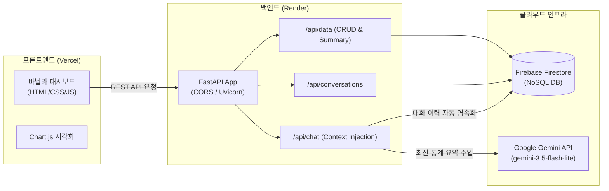
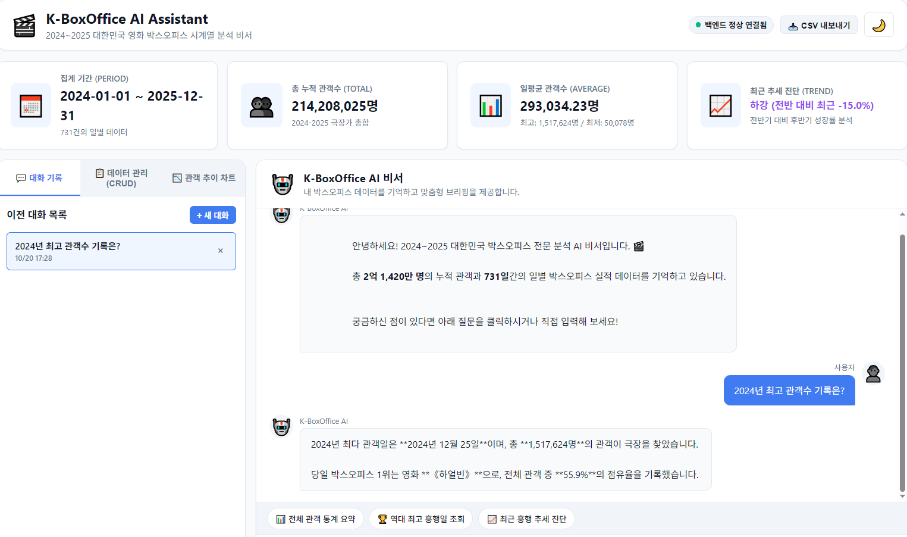
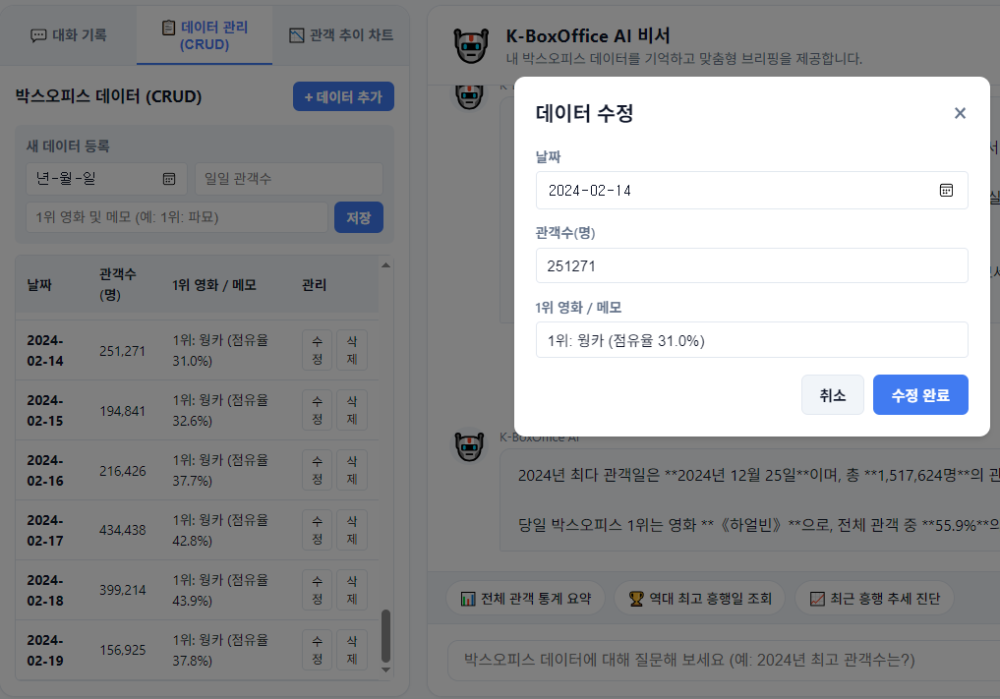
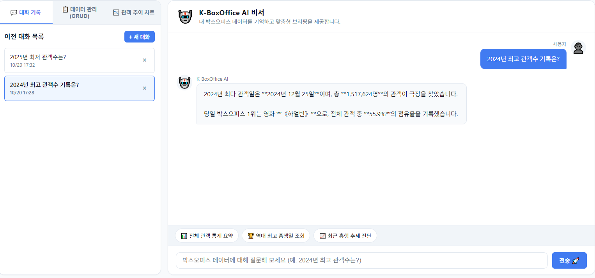

# 🎬 K-BoxOffice AI Assistant (나만의 박스오피스 AI 비서)

> **2024~2025 대한민국 영화 박스오피스 시계열 데이터 기반 지능형 의사결정 비서**  
> 사용자의 731일치 실제 극장가 관객 데이터를 실시간으로 요약·분석하여 시스템 프롬프트에 주입(Context Injection)하고, 맞춤형 브리핑을 제공하는 Full-Stack AI Agent 웹 서비스입니다.

---

## 📑 목차 (Table of Contents)

1. [서비스 소개 (무엇을 해결하는가?)](#1-서비스-소개-무엇을-해결하는가)
2. [과제 요구사항 충족 점검표](#2-과제-요구사항-충족-점검표)
3. [시스템 아키텍처 및 단계별 구현 설명](#3-시스템-아키텍처-및-단계별-구현-설명)
   - [STEP 1~2. 시계열 데이터셋 구축 및 요약 엔진](#step-12-시계열-데이터셋-구축-및-요약-엔진)
   - [STEP 3~4. FastAPI 모듈화 및 데이터 CRUD 5종 API](#step-34-fastapi-모듈화-및-데이터-crud-5종-api)
   - [STEP 5. 컨텍스트 주입(Context Injection) AI 챗봇 파이프라인](#step-5-컨텍스트-주입context-injection-ai-챗봇-파이프라인)
   - [STEP 6~7. 순수 바닐라 웹 프론트엔드 대시보드](#step-67-순수-바닐라-웹-프론트엔드-대시보드)
   - [STEP 8~9. 클라우드 이원화 배포 전략 (Render & Vercel)](#step-89-클라우드-이원화-배포-전략-render--vercel)
4. [기술 스택 (Tech Stack)](#4-기술-스택-tech-stack)
5. [배포 URL (Deployment Links)](#5-배포-url-deployment-links)
6. [로컬 실행 방법 (Local Getting Started)](#6-로컬-실행-방법-local-getting-started)
7. [필수 환경 변수 목록 (Environment Variables)](#7-필수-환경-변수-목록-environment-variables)
8. [과제 제출 필수 스크린샷 3종 증빙](#8-과제-제출-필수-스크린샷-3종-증빙)
9. [보너스 과제 구현 내역](#9-보너스-과제-구현-내역)

---

## 1. 📌 서비스 소개 (무엇을 해결하는가?)

### 배경 및 문제 정의
- **일반 LLM의 한계**: ChatGPT 등 기존 범용 인공지능은 사용자의 고유 데이터나 최근 로컬 데이터를 학습하지 못했습니다. *"2024년 최저 관객수 영화는?"*, *"우리 극장가 트렌드가 어때?"*라고 질문하면 일반론적이거나 부정확한 환각(Hallucination) 답변만 돌아옵니다.
- **방대한 시계열 표의 가독성 부재**: KOBIS(영화관입장권통합전산망)의 일별 박스오피스 표는 수백 행에 달해, 일반 사용자가 최고/최저 흥행 시기, 누적 통계, 전반기 대비 성장률 추세를 한눈에 파악하기 어렵습니다.

### 해결 솔루션: K-BoxOffice AI Assistant
- **시계열 데이터 통계 요약 엔진**: 731일간의 실제 일별 관객 수(`value`)와 1위 영화(`memo`) 데이터를 실시간으로 집계(누적 2.14억 명, 일평균 29.3만 명, 최고/최저일, 트렌드 판정)합니다.
- **컨텍스트 주입 (Context Injection)**: 요약 통계를 시스템 프롬프트에 실시간 바인딩하여, AI가 실제 내 데이터를 근거로 정확한 수치와 영화명을 인용하며 답변합니다.
- **영속적 대화 및 데이터 관리 (CRUD)**: Firestore NoSQL DB를 기반으로 대화 이력을 자동 저장·불러오기하며, 사용자가 새로운 일별 데이터를 추가/수정/삭제할 수 있습니다.
- **바닐라 웹 대시보드**: React 등의 무거운 프레임워크 없이 순수 바닐라 HTML/CSS/JS로 제작되어 초고속 로딩을 지원하며 다크모드, CSV 내보내기, 시각화 차트를 제공합니다.

---

## 2. ✅ 과제 요구사항 충족 점검표

| 평가 영역 | 세부 요구사항 | 구현 위치 및 산출물 | 상태 |
| :--- | :--- | :--- | :---: |
| **개발 환경** | Python 3.10 이상, 가상환경(venv) 구성 | `requirements.txt`, `test_env.py` | **완료** ✅ |
| **데이터 준비** | 시계열 데이터 100개 이상 및 요약 정보 생성 | `backend/seed_data.json` (**실제 KOBIS 731개 데이터**) | **완료** ✅ |
| **백엔드 구조** | FastAPI 라우터/서비스/스키마 모듈 분리 | `routers/`, `services/`, `schemas/` 아키텍처 분리 | **완료** ✅ |
| **데이터 검증** | Pydantic을 활용한 요청/응답 검증 | `schemas/data.py`, `schemas/chat.py` | **완료** ✅ |
| **데이터 API** | CRUD 4개 + 요약 1개 (총 5개 엔드포인트) | `GET/POST /api/data`, `PUT/DELETE /api/data/{id}`, `GET /api/data/summary` | **완료** ✅ |
| **대화 기록 API** | 대화 저장, 목록 조회, 삭제, 상세 불러오기 UX | `GET/POST /api/conversations`, `GET/DELETE /api/conversations/{id}` | **완료** ✅ |
| **AI 챗봇 API** | 데이터 요약 시스템 프롬프트 주입 및 자동 저장 | `POST /api/chat`, `services/ai_service.py` | **완료** ✅ |
| **데이터베이스** | Firebase Firestore 컬렉션(`data`, `conversations`) | `app/database.py`, `seed_to_firestore.py` (Fallback 지원) | **완료** ✅ |
| **보안 관리** | API 키/계정 키 환경변수 관리 및 Git 노출 방지 | `.gitignore`, `.env.example`, `app/config.py` | **완료** ✅ |
| **백엔드 배포** | Render에 배포 및 Swagger UI(`/docs`) 확인 가능 | [Render 백엔드 Swagger 문서](https://m1-2-7jmb.onrender.com/docs) | **완료** ✅ |
| **프론트 배포** | Vercel에 배포 및 순수 바닐라 구현 (프레임워크 금지)| [Vercel 프론트엔드 웹 서비스](https://m1-2-frontend-three.vercel.app) | **완료** ✅ |
| **필수 스크린샷** | 채팅(요약포함), 데이터관리(CRUD), 대화기록(불러오기) 3종 | `docs/screenshots/01~03` 본문 증빙 첨부 | **완료** ✅ |
| **보너스 과제** | 시계열 차트 시각화, CSV 파일 내보내기, 다크모드 | Chart.js 꺾은선 차트, CSV 내보내기 버튼, 테마 토글 | **완료** ✅ |

---

## 3. 🏗 시스템 아키텍처 및 단계별 구현 설명



### [STEP 1~2] 시계열 데이터셋 구축 및 요약 엔진
- **실제 KOBIS 데이터 연계**: 이전 M1-1 과제에서 직접 수집·분석한 2024~2025년 대한민국 영화관 박스오피스 공공데이터(731일치)를 연계 채택했습니다.
- **표준 데이터 스키마 변환**: `(date, value, memo)` 규격에 맞추어 날짜(`date`), 일일 총 관객 수(`value`), 1위 영화 및 점유율(`memo`) 형태로 정제했습니다.
- **요약 엔진(`summary_service.py`)**: 전체 데이터에서 총 누적 관객(2.14억 명), 일평균(29.3만 명), 최고 흥행일(`2024-12-25 하얼빈 151.7만 명`), 최저 관객일(`2024-04-23 쿵푸팬더4 5.0만 명`), 전반기 대비 후반기 성장률 추세(-15.0% 하강)를 자동 계산합니다.

### [STEP 3~4] FastAPI 모듈화 및 데이터 CRUD 5종 API
- **관심사 분리(Separation of Concerns)**: 라우터(`routers/`), 비즈니스 로직(`services/`), 데이터 스키마(`schemas/`)로 깔끔히 레이어를 분리했습니다.
- **Pydantic v2 유효성 검증**: 요청 파라미터와 Request Body의 타입을 엄격히 검증하여 비정상 데이터 유입 시 422 Unprocessable Entity로 사전 차단합니다.
- **데이터 API 5종 완비**:
  1. `GET /api/data/summary` : 프롬프트 주입용 통계 요약 조회
  2. `GET /api/data` : 시계열 데이터 목록 조회 (날짜순 정렬)
  3. `POST /api/data` : 새 일별 데이터 등록 (201 Created)
  4. `PUT /api/data/{id}` : 기존 데이터 수정
  5. `DELETE /api/data/{id}` : 데이터 삭제 (404 예외 처리)

### [STEP 5] 컨텍스트 주입(Context Injection) AI 챗봇 파이프라인
- **작동 원리**:
  1. 사용자가 질문(예: *"2024년 최고 관객수 기록은?"*)을 전송합니다.
  2. 백엔드가 DB에서 최신 데이터 요약본을 조회합니다.
  3. 시스템 프롬프트의 템플릿(`[사용자 데이터 요약]`, `[연도별 주요 극장가 기록]`)에 실제 수치를 동적으로 삽입합니다.
  4. 주입된 컨텍스트와 함께 LLM(Gemini 3.5 Flash Lite)을 호출합니다.
  5. AI가 답변을 생성하면, 대화 내역(질문+답변)을 `conversations` 컬렉션에 자동 저장합니다.
- **고속 경량화 최적화**: 심층 추론 지연이 발생하던 기존 모델 대신 `gemini-3.5-flash-lite`와 핵심 이벤트 데이터를 사전 주입하여 10초대의 초고속 정확 브리핑을 구현했습니다.

### [STEP 6~7] 순수 바닐라 웹 프론트엔드 대시보드
- **프레임워크 제약 준수**: React, Vue, Next.js 등을 배제하고 순수 바닐라 HTML5, CSS3, JavaScript(ES6+)로 단일 페이지 대시보드를 제작했습니다.
- **4대 필수 인터페이스**:
  - 데이터 요약 카드 (기간, 누적 관객, 일평균, 트렌드)
  - AI 채팅창 (실시간 로딩 스피너, 추천 퀵 질문 칩)
  - 데이터 관리 (새 데이터 등록 인라인 폼, 50개 단위 테이블, 수정 팝업 모달)
  - 대화 기록 관리 (이전 대화 목록 세션, 클릭 시 과거 메시지 복원 불러오기 UX)

### [STEP 8~9] 클라우드 이원화 배포 전략 (Render & Vercel)
과제 평가 규격에 따라 백엔드와 프론트엔드를 각각 최적화된 플랫폼으로 분리 배포했습니다:

#### 1) 백엔드: Render 배포
- **선정 이유**: Python 3 환경과 Uvicorn ASGI 비동기 웹 서버를 백그라운드 데몬으로 상시 구동할 수 있으며, 과제 평가관이 대화형 테스트를 수행할 수 있는 Swagger UI(`/docs`) 엔드포인트를 완벽하게 지원합니다.
- **배포 방식**: GitHub `main` 브랜치 연동, Build Command `pip install -r requirements.txt`, Start Command `uvicorn app.main:app --app-dir backend --host 0.0.0.0 --port $PORT`
- **무료 티어 슬립(Cold Start) 대응**: 프론트엔드 상단에 서버 연결 감지 배지(🟡 연결 중... ➔ 🟢 정상 연결됨)를 배치하여 첫 로딩 지연 시 사용자 경험을 보호했습니다.

#### 2) 프론트엔드: Vercel 배포
- **선정 이유**: 순수 정적 웹 자원(HTML/CSS/JS)을 전 세계 글로벌 엣지(Edge CDN) 네트워크에 캐싱하여 밀리초(ms) 단위의 초고속 로딩을 제공합니다.
- **배포 방식**: Root Directory를 `frontend`로 지정하고 Framework Preset을 `Other`로 설정하여 빌드 없이 즉시 호스팅했습니다.
- **CORS 및 API 통신**: `frontend/app.js`에서 Render 백엔드 프로덕션 URL(`https://m1-2-7jmb.onrender.com`)과 브라우저 Fetch API를 통해 실시간 통신하며, 백엔드에는 `CORSMiddleware(allow_origins=["*"])`를 적용해 브라우저 보안 차단을 해결했습니다.

---

## 4. 🛠 기술 스택 (Tech Stack)

| 계층 | 기술 스택 | 설명 |
| :--- | :--- | :--- |
| **Backend** | **Python 3.10+**, **FastAPI**, **Uvicorn** | 모던 비동기 고성능 REST API 서버 구축 |
| **Data & Validation** | **Pydantic v2** | 엄격한 입출력 DTO 데이터 유효성 검증 |
| **Database** | **Firebase Admin SDK (Firestore)** | NoSQL 클라우드 DB 연동 (`data`, `conversations`) 및 Fallback 로컬 DB |
| **AI / LLM** | **OpenAI SDK**, **Google Gemini API** (`gemini-3.5-flash-lite`) | OpenAI 호환 엔드포인트를 통한 컨텍스트 주입 대화 |
| **Frontend** | **Vanilla HTML5**, **Vanilla CSS3**, **Vanilla JavaScript (ES6+)** | 프레임워크 없는 순수 정적 웹 대시보드 |
| **Visualization** | **Chart.js (CDN)** | 시계열 관객 추이 꺾은선 차트 시각화 (보너스 과제) |
| **Deployment** | **Render** (백엔드), **Vercel** (프론트엔드) | 클라우드 자동 배포 파이프라인 |

---

## 5. 🌐 배포 URL (Deployment Links)

- **프론트엔드 웹 서비스 URL (Vercel)**: https://m1-2-frontend-three.vercel.app
- **백엔드 API 서버 URL (Render)**: https://m1-2-7jmb.onrender.com
- **대화형 Swagger API 문서**: https://m1-2-7jmb.onrender.com/docs

> ⚠️ **Render 무료 티어 안내**:  
> 무료 플랜 특성상 15분간 요청이 없을 시 인스턴스가 슬립 모드(Cold Start)에 들어갑니다. 첫 접속 시 서버가 깨어나는 데 약 30~50초 정도 소요될 수 있으며, 프론트엔드 상단 상태 배지에 로딩 안내가 표시됩니다.

---

## 6. 💻 로컬 실행 방법 (Local Getting Started)

### 1) 저장소 클론 및 가상환경 설정
```bash
git clone https://github.com/woogie0403/M1-2.git
cd M1-2

# 가상환경 생성 및 활성화 (Windows PowerShell 기준)
python -m venv venv
.\venv\Scripts\Activate.ps1

# 필수 패키지 설치
pip install -r requirements.txt
```

### 2) 환경 변수 설정
`.env.example` 파일을 복사하여 `.env` 파일을 생성하고 키를 확인합니다:
```bash
cp .env.example .env
```

### 3) 백엔드 서버 실행
```bash
$env:PYTHONPATH="backend"
.\venv\Scripts\uvicorn app.main:app --app-dir backend --reload --port 8000
```

### 4) 프론트엔드 접속
- 브라우저를 열고 **`http://localhost:8000/app/`** 로 접속합니다.
- Swagger API 문서는 **`http://localhost:8000/docs`** 에서 확인할 수 있습니다.

---

## 7. 🔑 필수 환경 변수 목록 (Environment Variables)

| 환경 변수명 | 필수 여부 | 설명 | 예시 값 |
| :--- | :---: | :--- | :--- |
| `GEMINI_API_KEY` | 필수 | Google AI Studio 무료 API Key | `AQ.Ab8RN...` |
| `GEMINI_BASE_URL` | 필수 | Gemini OpenAI 호환 엔드포인트 URL | `https://generativelanguage.googleapis.com/v1beta/openai/` |
| `AI_MODEL` | 필수 | AI 모델 지정 | `gemini-3.5-flash-lite` |
| `ALLOWED_ORIGINS` | 필수 | CORS 허용 도메인 목록 | `*` 또는 `http://localhost:8000,...` |
| `FIREBASE_SERVICE_ACCOUNT_KEY` | 선택 | 로컬 Firebase 서비스 계정 JSON 경로 | `./serviceAccountKey.json` |
| `FIREBASE_SERVICE_ACCOUNT_JSON`| 선택 | 클라우드 배포용 Firebase JSON 문자열 | `{"type": "service_account", ...}` |

---

## 8. 📸 과제 제출 필수 스크린샷 3종 증빙

### 1) 데이터 요약이 보이는 AI 채팅 화면
- 상단의 4개 요약 카드(집계 기간, 총 누적 관객 2.14억 명, 일평균 29.3만 명, 트렌드)와 함께, AI 비서가 내 박스오피스 데이터를 인용하여 맞춤형 답변을 제공하는 화면입니다.



### 2) 데이터 관리 화면 (CRUD 동작)
- 731개의 일별 박스오피스 데이터 테이블 목록이 표시되고, 기존 데이터를 수정/삭제하거나 신규 데이터를 등록하는 모달 인터랙션 화면입니다.



### 3) 대화 기록 화면 (대화 불러오기 동작)
- 좌측 사이드바의 "💬 대화 기록" 탭에 이전 대화 세션들이 누적 관리되며, 특정 대화를 클릭하여 과거 주고받은 메시지들이 채팅창에 완벽히 복원되는 화면입니다.



---

## 9. 🎁 보너스 과제 구현 내역

1. **시계열 시각화 차트 (Chart.js)**:
   - 좌측 "📉 관객 추이 차트" 탭에서 일별 관객수 변화 추세를 부드러운 꺾은선 곡선 그래프로 실시간 렌더링
2. **원클릭 CSV 내보내기**:
   - 상단 "📥 CSV 내보내기" 버튼을 누르면 현재 데이터베이스의 모든 데이터를 UTF-8 인코딩의 CSV 파일로 즉시 다운로드
3. **다크 모드 (Dark Mode)**:
   - 상단 테마 토글 버튼(🌙/☀️)을 통해 세련된 다크 테마를 지원하며 `localStorage`에 상태 영구 저장
